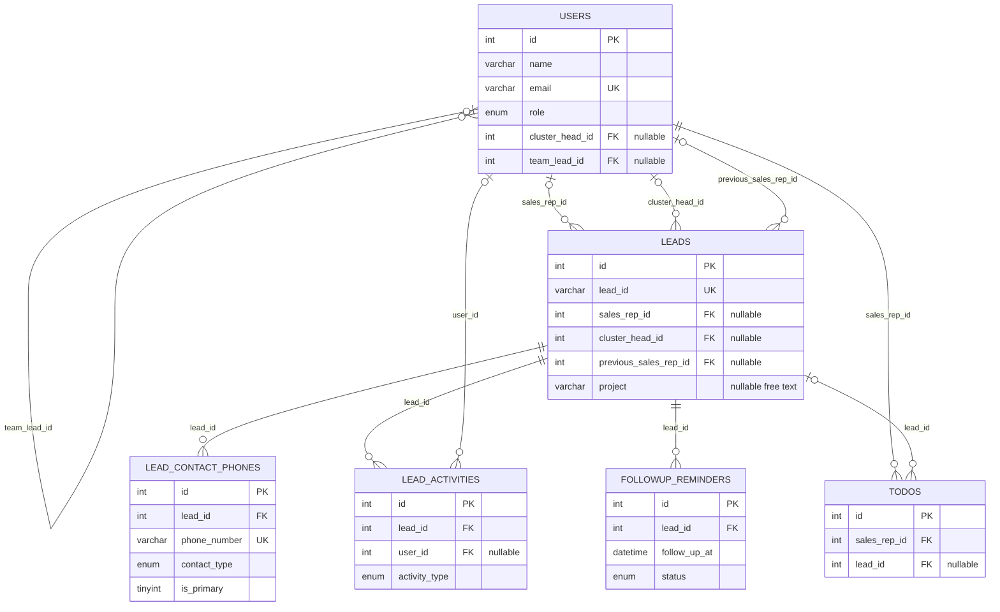

# Database relationship map (from SQL foreign keys)

All edges below are defined by foreign keys in `rpl_crm.sql`, rather than inferred from query joins. A child FK that is `NOT NULL` requires a parent row; a nullable FK can be absent. Parent-to-child counts are zero-to-many where no UNIQUE constraint exists. No FK column in this schema is unique, so the database does not enforce one-to-one relationships.

## Cardinality and delete semantics

- `leads.sales_rep_id`, `cluster_head_id`, and `previous_sales_rep_id` are nullable references to `users.id`: each lead has zero or one referenced user per role; one user may be referenced by many leads. Deleting a user sets each of these lead references to NULL.
- `users.cluster_head_id` and `users.team_lead_id` are nullable self-references: each user has zero or one referenced user for each hierarchy link; a parent user can be referenced by many users. Deleting the referenced user sets the corresponding field to NULL.
- `lead_contact_phones.lead_id` is non-null: every phone row belongs to one lead; a lead can have many. Deleting a lead cascades to phone rows.
- `lead_activities.lead_id` is non-null: every activity belongs to one lead; a lead can have many. Deleting a lead cascades to activities. `user_id` is nullable, and deleting that user sets it to NULL.
- `followup_reminders.lead_id` is non-null: every reminder belongs to one lead; a lead can have many. Deleting a lead cascades to reminders.
- `todos.sales_rep_id` is non-null: every task belongs to one user; a user can have many. Deleting that user cascades to their tasks.
- `todos.lead_id` is nullable: a task may have no associated lead; a lead can be referenced by many tasks. Deleting a lead sets this field to NULL.

Every FK omits `ON UPDATE`; the dump therefore relies on MariaDB's default restrictive behavior for updates to referenced keys. There are no declared unique constraints on FK columns. Consequently, no one-to-one relationship is enforced. Other relationships suggested by application SQL but not represented as FKs (for example `leads.project` to a project catalog) are deliberately absent from this verified ERD.
