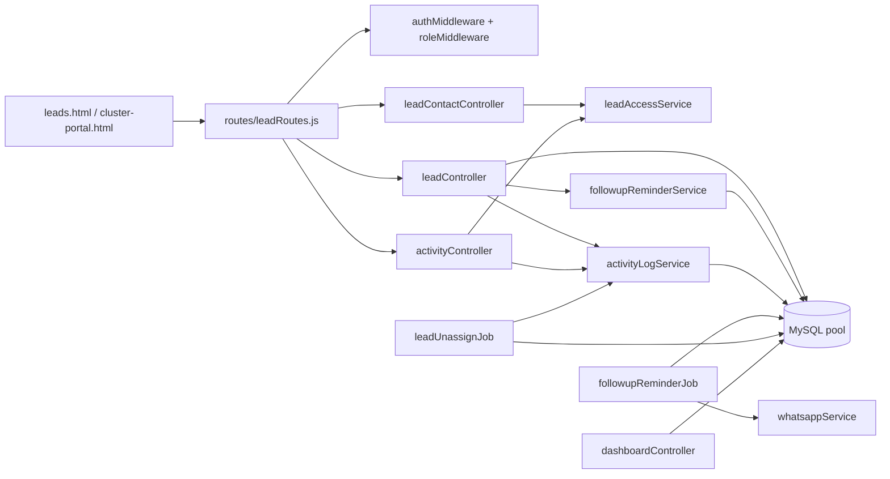

# Lead management deep dive

## End-to-end shape

Frontend: `public/leads.html` (create/edit/list/activity/contact/to-do) and `public/cluster-portal.html` (cluster view/transfer/edit). Their `apiFetch` wrappers send cookies. API routes are in `routes/leadRoutes.js`; handlers are in lead/contact/activity controllers; reusable access, reminder, activity operations are in `services/`; schema is in `rpl_crm.sql`.

## Create and ownership

`public/leads.html` create form posts `POST /api/leads`. Backend `leadController.createLead` requires truthy `lead_name` and `lead_phone`; other fields are mostly passed through/defaulted. It creates `LD-YYMMDD-NNNN` by selecting the latest matching daily ID, inserts the lead and primary contact phone in one transaction, then synchronizes a reminder (if date supplied) and writes `created` activity outside that transaction. Owner is always authenticated user ID; cluster head is self for `CLUSTER_HEAD`, otherwise JWT `cluster_head_id`. `previous_sales_rep_id` and unassigned time initially rely on NULL defaults.

Duplicate phone is caught as `ER_DUP_ENTRY` because phone numbers are globally UNIQUE. Lead ID generation can race on simultaneous creates; unique lead_id catches collision but no retry/sequence lock exists. Backend does not comprehensively validate lengths, enums, phone format, date, category, or numeric space value before insert. Schema constraints handle NOT NULL/ENUM/length/FK rules subject to database SQL mode.

## Listing, assignment, update

Profession is optional, limited to 150 characters in the browser and checked server-side. Project choices load from `public/project-list.json`; Location and Category display read-only and are derived from JSON by `services/projectConfigService.js`, not trusted from request input. The owner reports `leads.profession` and `leads.project_location` were added to the local DB; they are absent from `rpl_crm.sql`. Category reuses existing `leads.category`. Main and cluster edit forms load these values and retain unconfigured legacy project names as temporary options. The server preserves stored legacy Project/Location/Category if the project remains unchanged; selecting a configured project derives Location/Category from JSON.

`getLeads` dynamically scopes by role, joins current and previous owners, filters stage/status/search/member/cluster/today/stale/unassigned, and sorts descending ID. CH scope gathers users by cluster_head_id; TL scope dynamically obtains current reports plus self; SM sees self; DD/ED can select assigned or unassigned. No pagination is evident.

Transfer route is only DD_ED/CLUSTER_HEAD. Controller validates target role SALES_MAN; CH may only transfer within own cluster and only a lead whose current owner's cluster matches. It updates sales rep, cluster, clears previous owner and unassigned timestamp, then logs transfer activity. The schema's previous owner field is only populated by the stale release job (transfer clears it); app operation is not atomic with activity.

`updateLead` allowlists editable fields and checks missing lead and ownership for SM, TL, CH; DD_ED passes without narrower object check. It changes lead row, then reminder sync if follow-up/stage/status included, then writes field-change activities serially. No lead deletion endpoint exists. `leads.status` enum is Active/Converted/Lost/On Hold; stage is Lead/Prospect/Priority. Meeting flags are No/Yes.

## Follow-ups and jobs

`leads.next_follow_up` is the canonical next date on lead row; `followup_reminders` stores cycles/attempt metadata, one-to-many by FK, without uniqueness of active cycle. `syncReminderForLead` cancels all active reminders for lead, then inserts one active reminder only if date is future and status Active. Lead create/update calls it conditionally. Job runs every 10 minutes, marks overdue active reminder rows done, selects due-soon candidates within four hours with cadence checks, sends WhatsApp, then updates count/last_sent_at. Daily 02:00 job unassigns active stale leads with no future follow-up and 120-day old update, cancels reminders and logs system activity. Each action is process-local and concurrent instances may duplicate work.

## Contacts and activity

Phone controller app caps lead phones at four and spouse phones at two; DB enforces globally unique phone_number only. Primary lead phone changes synchronize `leads.lead_phone`. Deleting primary picks earliest remaining lead phone, but delete/fallback is not transactional. Spouse rows always use `is_primary=0`; spouse name is stored on leads.

Activity types in schema: created, call, note, meeting, stage_change, status_change, follow_up_set, meeting_update, transfer, unassigned. Create, update changes, transfer, stale release are automatic; user can manually post activity type/description through timeline endpoint. Schema enum enforces accepted activity values. `logActivity` inserts then separately updates lead updated_at; failure between them can leave partial behavior. User actor nullable supports system events.

## Reporting dependencies

Lead cards now include Profession when present and include Location alongside Project when present. These fields flow from `leads.*` in `getLeads`; personal KPI selects do not expose the full lead detail and remain unchanged.

`dashboardController` aggregates leads by stage/category/status/source/unmet reason/project/engagement. Personal dashboard includes today's followups, 30-day stale leads and recent conversions. Team/org methods query per rep in loops (N+1). `leads.project` is free text. Team Lead `/my-stats` currently uses self ID only despite route allowing TL; dashboard counters differ from TL lead list scope.

## Verification boundaries

Static source and dump review only. No browser interaction, SQL execution, live data, or production job behavior was tested. See workflow documents and permission matrix for details.

## Cross-module dependencies

