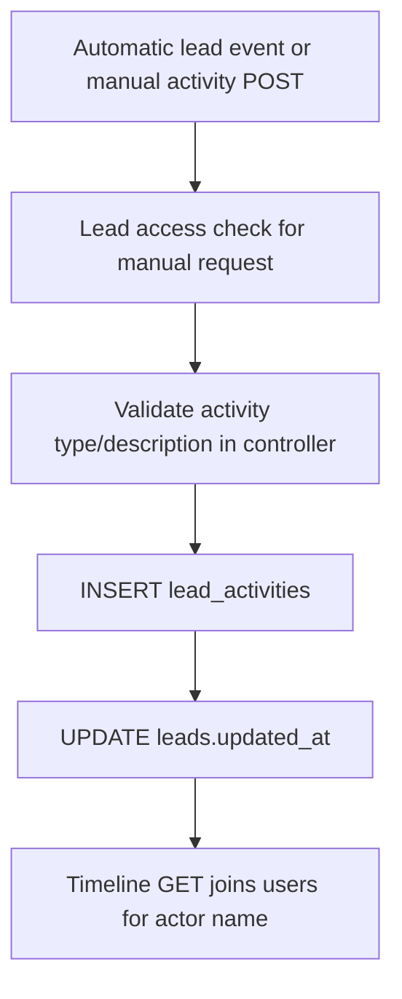

# Activity timeline workflow

System events may use NULL actor. Activity insert and timestamp update are separate queries. Sources: `controllers/activityController.js`, `services/activityLogService.js`, lead/user job callers.
