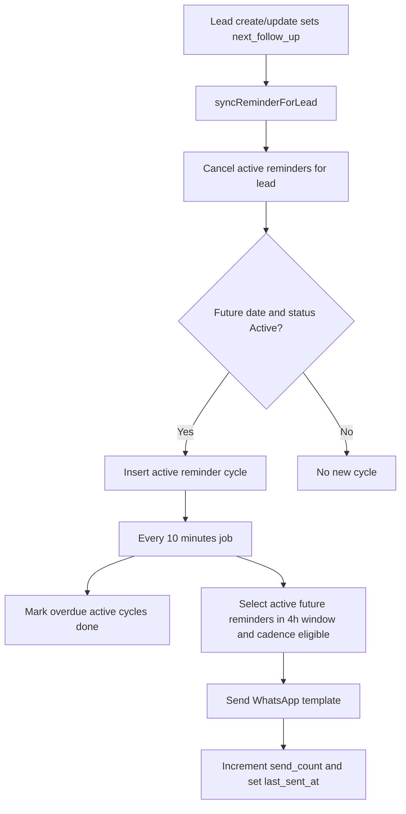

# Follow-up workflow

Lead date is stored in `leads.next_follow_up`; reminder row is dispatch state. There is no unique active-cycle constraint. Sending and post-send update are separate, so failure can cause repeat sends. `services/followupReminderService.js`, `jobs/followupReminderJob.js`, `services/whatsappService.js`.
