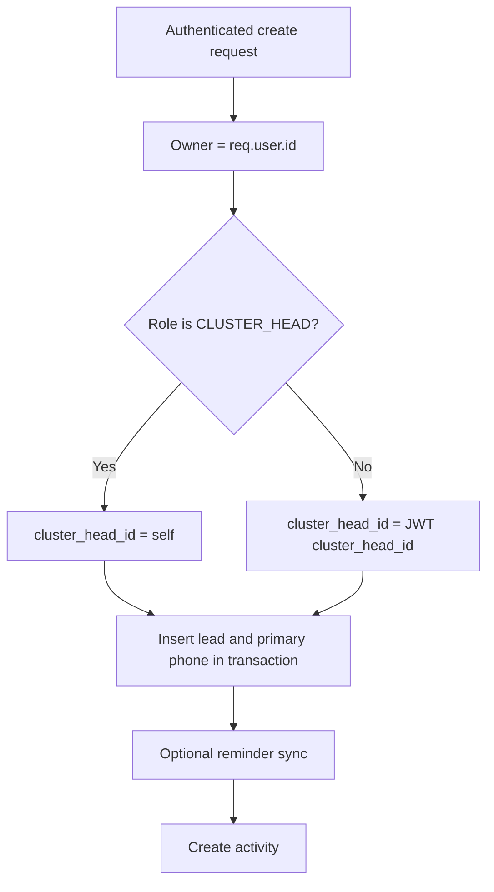

# Lead initial assignment workflow

No create payload target-owner field is used: initial owner is the caller. Database FKs require referenced IDs if non-null, but do not validate hierarchy role semantics. `controllers/leadController.js:createLead`.
