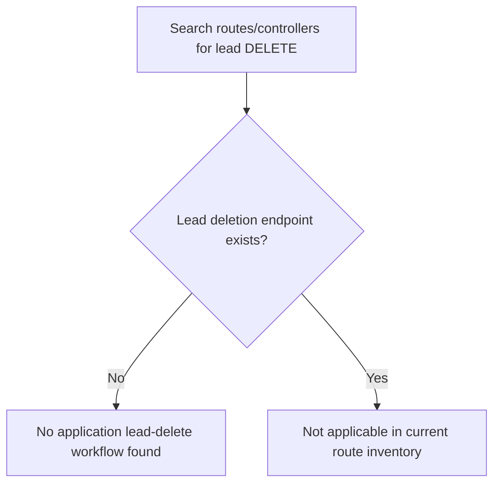

# Lead deletion workflow

No lead deletion API or UI workflow was found. This reflects the inspected repository, not an assertion that operators cannot delete directly in a database tool. If a lead row is deleted at DB level, actual FK behavior cascades to `lead_contact_phones`, `lead_activities`, and `followup_reminders`; optional `todos.lead_id` becomes NULL. No app authorization/confirmation/audit workflow covers such a direct deletion.
