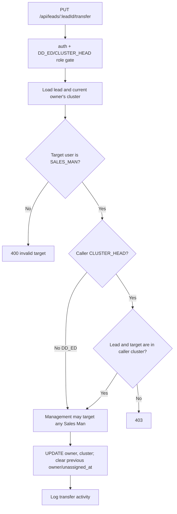

# Lead reassignment workflow

The DB update and activity insertion are not one transaction. A current unassigned lead can be assigned by DD/ED; CH authorization checks current rep cluster, so an unassigned lead has no current rep cluster and fails that check. `controllers/leadController.js:transferLead`, `routes/leadRoutes.js`.
