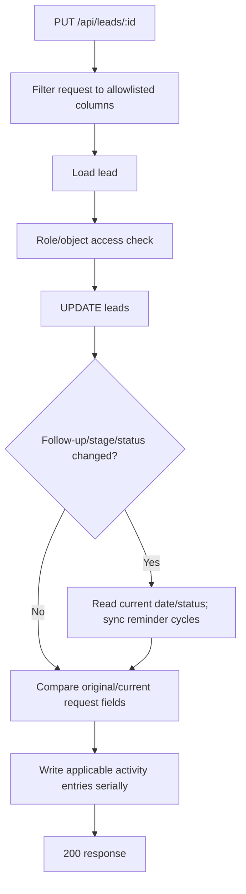

# Lead update workflow

This is not a transaction spanning lead, reminder, and activity changes. Editable fields are listed in `controllers/leadController.js:updateLead`; there is no lead DELETE route.
